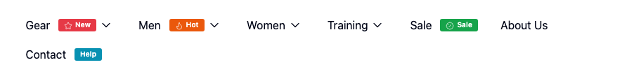
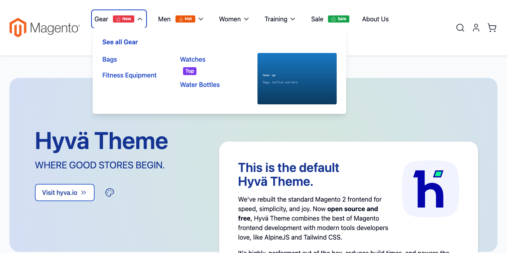
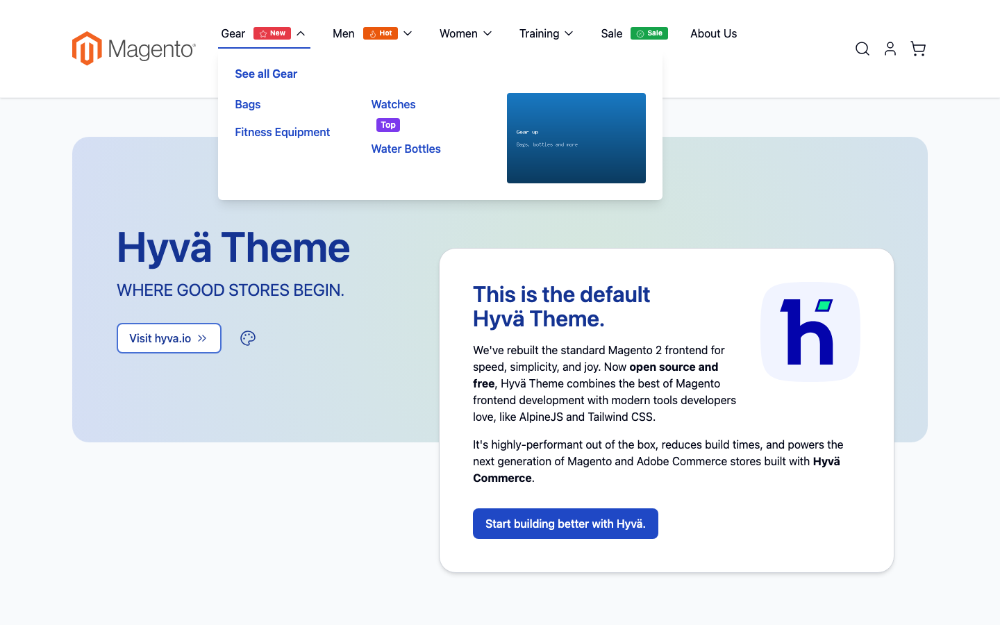
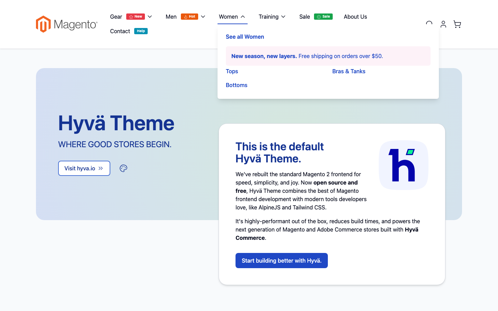
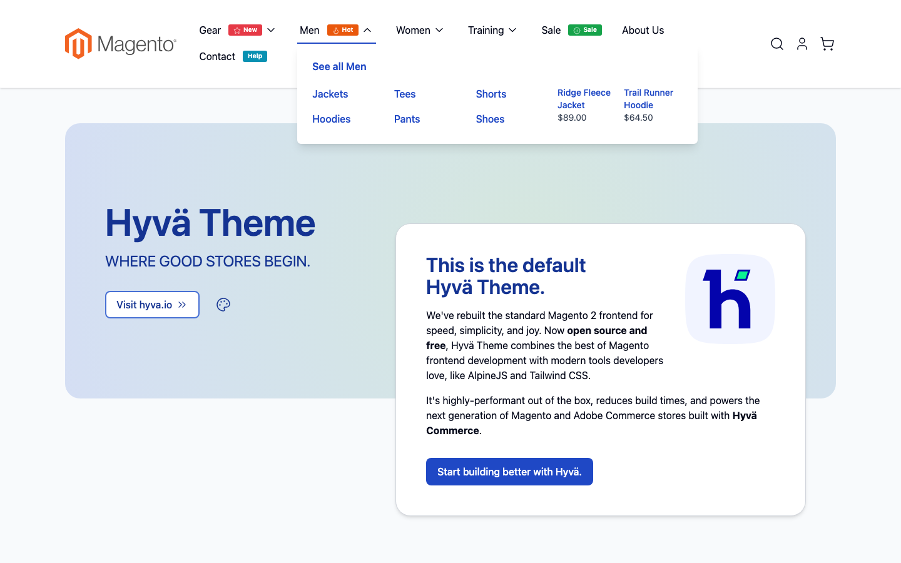
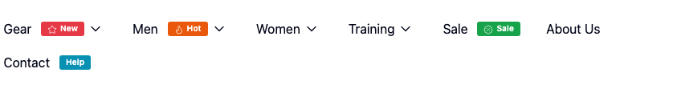
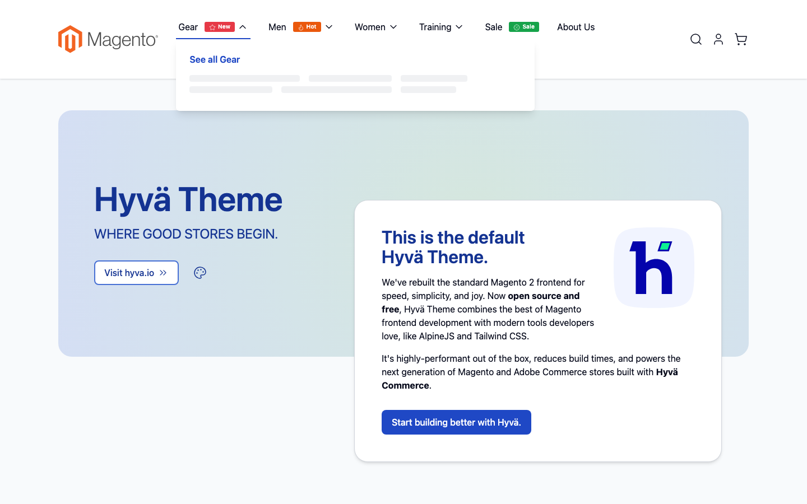
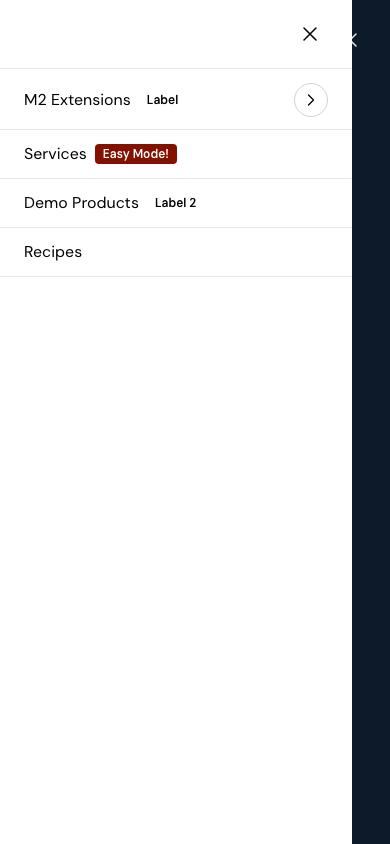
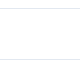
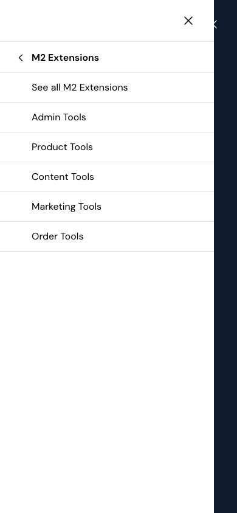

# BlueFairy_MegaMenuHyva — Features Guide

Visual walkthrough of all Hyva frontend features and mega menu behavior.

---

## Table of Contents

1. [Desktop Navigation — Mega Menu Overview](#1-desktop-navigation--mega-menu-overview)
   - 1.1 [Menu at Rest](#11-menu-at-rest)
   - 1.2 [Panel Opens on Hover](#12-panel-opens-on-hover)
   - 1.3 [Panel Closes on Mouse Away](#13-panel-closes-on-mouse-away)
   - 1.4 [CMS Page and Custom Link Items](#14-cms-page-and-custom-link-items)
2. [Desktop Mega Menu Panel Layout](#2-desktop-mega-menu-panel-layout)
   - 2.1 [Category Tree Columns](#21-category-tree-columns)
   - 2.2 [Featured Image](#22-featured-image)
   - 2.3 [Featured CMS Block](#23-featured-cms-block)
   - 2.4 [Featured Products](#24-featured-products)
   - 2.5 [Label Badge](#25-label-badge)
3. [Desktop Loading & Performance](#3-desktop-loading--performance)
   - 3.1 [Skeleton Loading State](#31-skeleton-loading-state)
   - 3.2 [GraphQL Lazy-Loading](#32-graphql-lazy-loading)
   - 3.3 [Per-Item Cache](#33-per-item-cache)
4. [Mobile Navigation — Accordion](#4-mobile-navigation--accordion)
   - 4.1 [Accordion at Rest](#41-accordion-at-rest)
   - 4.2 [Expanding Items](#42-expanding-items)
   - 4.3 [Chevron Icon Rotation](#43-chevron-icon-rotation)
   - 4.4 [Mobile Featured Image](#44-mobile-featured-image)
   - 4.5 [Mobile Subcategory Stack](#45-mobile-subcategory-stack)
5. [Keyboard Navigation & Accessibility](#5-keyboard-navigation--accessibility)
   - 5.1 [Escape Key Closes Panel](#51-escape-key-closes-panel)
   - 5.2 [Focus Management](#52-focus-management)
6. [Alpine.js Component Architecture](#6-alpinejs-component-architecture)
   - 6.1 [Components](#61-components)
   - 6.2 [Methods & Event Handling](#62-methods--event-handling)
   - 6.3 [GraphQL Integration](#63-graphql-integration)
   - 6.4 [Strict CSP](#64-strict-csp)

---

## 1. Desktop Navigation — Mega Menu Overview

The mega menu is the primary navigation interface on desktop screens. Top-level categories with mega menu enabled display an interactive panel on hover.

### 1.1 Menu at Rest

The desktop navigation bar displays top-level categories in a horizontal layout. Categories that do not have mega menu enabled appear as simple links.



**Navigation structure:**
- A top-level category with a panel or child categories is one toggle button: its name and a chevron that points down
  while closed and turns up while open. The category page is the panel's first link, **See all <category>**
- Categories without a panel or children, CMS Page items and Custom Link items are plain links


- All other interactive elements (logo, search, account menu) remain unchanged

---

### 1.2 Panel Opens on Hover

When the user hovers over a top-level category that has mega menu enabled, a mega menu panel opens below the category.


**Panel behaviour:**
- The panel appears immediately (no delay) when the user moves the mouse over the category
- It starts with a **See all <category>** link to the category page, then the category tree
- The panel remains open while the mouse is over the panel itself
- The panel displays category tree, featured image, featured CMS block, or featured products (depending on configuration)
- The panel is at least 40rem wide and at most the `max-w-screen-xl` width (`min-w-[40rem] max-w-screen-xl`); it
  opens aligned to the item's left edge, or to its right edge when it would overflow the window
- The panel is positioned below the navigation bar and floats above page content

---

### 1.3 Panel Closes on Mouse Away

When the user moves the mouse away from both the category link and the open panel, the panel closes.


**Closing behaviour:**
- The panel closes when the mouse exits the bounding box of the category link and the open panel
- Closing is immediate (no delay)
- The panel does not close while the user is interacting with content inside the panel (e.g., hovering over a subcategory link)

---

### 1.4 CMS Page and Custom Link Items

CMS Page and Custom Link menu items (Menu Items form, core module) are plain top-level links after the categories -
on the desktop bar and in the mobile menu - with their label badge, and open no panel. See `MegaMenu/FEATURES.md`
section 2.5.

---

## 2. Desktop Mega Menu Panel Layout

The mega menu panel supports multiple layout options configured per category in the admin. The panel is fetched over GraphQL on first hover (lazy-loading) and kept in memory for five minutes of the page visit.

### 2.1 Category Tree Columns

The primary panel content is the category's direct children, as links in columns. The panel content is built by
the core module (`BlueFairy\MegaMenu\Model\Panel\PanelDataBuilder`) and fetched over the `megaMenuPanel` GraphQL
query; the settings are the core module's (see `MegaMenu/FEATURES.md`, section 2).


**Columns:**
- The column count is the category's menu row's: 2, 3 or 4 from the category form (default 4), 1 to 6 from the
  Menu Items form; a row with none uses the store's *Default Column Count* (default 4).
- Each column takes the next (children ÷ column count, rounded up) children in category order, so a panel can
  show fewer columns than the count; an empty column is left out.
- A child with a child override shows its label badge beside its name, and links to the override's URL when that
  URL passes the shared rule (otherwise to its category, as on the phone menu).
- All columns sit on one row; the panel is at least 40rem wide and moves to the right-hand edge when it would
  overflow the viewport.

---

### 2.2 Featured Image

An *Image* panel shows a picture in a fixed 200 px column beside the links.



**Image behaviour:**
- The picture is shown from the menu row's *Featured Image URL* (Menu Items form) when one is set and is an
  `http(s)://` or root-relative URL - the server (`Model\SafeUrl`) and the browser (`safeUrl()`) both refuse
  `//host`, a backslash and control characters - otherwise from the uploaded *Featured Image* in
  `pub/media/bluefairy/megamenu/` (the core's `Model\FeaturedImage`).
- It links to the row's *Custom URL*, else to the category.

---

### 2.3 Featured CMS Block

A *CMS Block* panel renders an active CMS block across the panel's width.



**CMS block behaviour:**
- The block is chosen from a searchable list of CMS blocks; an inactive or missing block shows nothing.
- The server renders it through Magento's CMS filter (directives processed), drops PageBuilder `<style>` blocks and
  decodes PageBuilder HTML wrappers.
- In the browser, `sanitizeCmsHtml()` parses it into an inert document and removes `script`, `style`, `iframe`,
  `frame`, `frameset`, `object`, `embed`, `template`, `svg`, `math`, `link`, `meta`, `base`, `noscript`, `noembed`
  and `noframes` elements, every `on*` and `srcdoc` attribute, and `javascript:`/`data:`/`vbscript:` URLs before
  Alpine inserts it.

---

### 2.4 Featured Products

A *Products* panel lists the row's featured products in a fixed 200 px column beside the links - a static list,
not a carousel.



**Product behaviour:**
- The products are the row's featured product IDs, in that order (*Featured Product IDs* on the category form,
  comma-separated; or the Menu Items form's multi-select).
- Only enabled products visible in the store are shown; each with its image, name and price (the customer group's
  final price, in the current currency), linking to the product. No add-to-cart.
- They come in the same `megaMenuPanel` response as the rest of the panel. If none can be shown, the panel shows
  the links only.

---

### 2.5 Label Badge

A label badge can be applied to a top-level category to display a small label beside the category link in the navigation bar.



**Badge behaviour:**
- The badge displays as a small inline element next to the category link text, on desktop and mobile.
- Its text, hex background colour, font size and corner radius come from the category's menu row (the size and
  radius fall back to the store's defaults).
- It does not affect hover or click behaviour of the category link.

| Property | Values | Default | Effect |
|----------|--------|---------|--------|
| Label Badge Text | Free text | (empty) | The text displayed in the badge. Leave blank to hide the badge. |
| Label Badge Color | Text: `#rgb` or `#rrggbb` | (empty) | The background colour. Anything else - RGB, a colour name - falls back to the default blue (`#2563eb`). |
| Label Badge Icon | None, Star, Flame, New, Sale, Hot | None | Optional icon inside the badge (Menu Items form), drawn from Hyvä's Lucide set: star, flame, sparkles (New), badge-percent (Sale), flame-kindling (Hot) - the same glyphs the Luma menu shows. A name Lucide cannot draw shows the badge without an icon (logged as a warning). |

---

## 3. Desktop Loading & Performance

The mega menu is optimized for performance using lazy-loading, skeleton states, and an in-page panel cache.

### 3.1 Skeleton Loading State

When the user hovers over a category and the panel is loading from GraphQL, a skeleton loading state is displayed.



**Skeleton behaviour:**
- Pulsing placeholder columns appear while the GraphQL query is in-flight
- The skeleton mimics the shape of the final column tree (height, column count, text widths)
- The skeleton fades out and is replaced with the loaded content when the GraphQL response arrives
- The skeleton is only visible during the initial fetch; cached panels load instantly
- If the query fails (a GraphQL error or a network error), the skeleton is replaced with a fallback (plain child links)
- A request still running after 8 seconds is abandoned and the skeleton stays; the panel is fetched again the next time it opens

---

### 3.2 GraphQL Lazy-Loading

Panel content is fetched on-demand via GraphQL on the first hover over a category.

**Fetch behaviour:**
- The `megaMenuPanel` GraphQL query is sent to the Magento GraphQL endpoint
- The query includes the category ID and requests the panel structure, featured content, and child categories
- A loaded panel is reused for 5 minutes on the same page, then fetched again
- An **AbortController with an 8-second timeout** cancels the request if it takes longer than 8 seconds
- If the request fails (a GraphQL error or a network error), the panel shows plain child category links instead
- An abandoned (timed-out) request is not a failure: the skeleton stays, and the next opening fetches again

**GraphQL Query:**

```graphql
query GetMegaMenuPanel($categoryId: Int!) {
  category(id: $categoryId) {
    id
    name
    children_count
    children {
      id
      name
      url_key
      children {
        id
        name
        url_key
      }
    }
    mega_menu_panel {
      featured_type
      featured_image_path
      featured_image_url
      cms_block_id
      columns_count
      label_badge_text
      label_badge_color
      products {
        id
        name
        price
        image_url
      }
    }
  }
}
```

---

### 3.3 Per-Item Cache

Once loaded, a category's mega menu panel is cached in the Alpine.js component state for 5 minutes, on that page.

**Caching behaviour:**
- The panel data is stored in the Alpine component's `panelCache` object keyed by `category_id`
- Subsequent hovers over the same category retrieve data from the cache (instant load)
- The cache lives in the page: refreshing or loading another page starts with an empty cache
- An entry older than 5 minutes is dropped and fetched again the next time the panel opens
- Restoring the page from the back-forward cache (`pageshow`) closes any open panel; it does not clear the cache
- While an entry is fresh, repeat hovers send no GraphQL request

---

## 4. Mobile Navigation — Accordion

On mobile screens, the mega menu is transformed into a collapsible accordion navigation. Categories are collapsed by default and expand on tap.

### 4.1 Accordion at Rest

The mobile navigation displays all top-level categories in a collapsed accordion state.



**Accordion structure:**
- Each top-level category is an accordion item
- Categories are listed vertically in a scrollable drawer
- By default, all accordion items are collapsed (closed)
- Each item shows the category name and a chevron icon (if the category has children)
- No mega menu panel is visible at rest

---

### 4.2 Expanding Items

When the user taps a category name, the accordion item expands to reveal the category's child items.


**Expansion behaviour:**
- The accordion item expands smoothly (animated height transition)
- Child categories are revealed in a bulleted or indented list format
- Child items are clickable links that navigate to the category page
- The category name itself is also clickable and navigates to the category page
- Multiple accordion items can be expanded simultaneously (or optionally, only one at a time depending on configuration)

| Property | Values | Default | Effect |
|----------|--------|---------|--------|
| Multiple Open | Yes / No | Yes | Allow multiple accordion items to be open at the same time, or close others when one is opened. |

---

### 4.3 Chevron Icon Rotation

Each accordion item with children displays a chevron icon that rotates to indicate open/closed state.



**Chevron behaviour:**
- The chevron icon rotates **0° (pointing right)** when the accordion item is collapsed
- The chevron icon rotates **90° (pointing down)** when the accordion item is expanded
- The rotation is animated (0.3s ease transition)
- The chevron is only visible if the category has children (`has_children = true`)
- Categories with no children do not display a chevron (they are simple links)

---

### 4.4 Mobile Featured Image

When configured, a featured image can also display in the mobile accordion panel. The image is rendered above the list of child categories.



**Mobile image behaviour:**
- The featured image is rendered as a linked image at the top of the expanded accordion item
- Image is responsive and scales to fit the viewport width (with padding)
- The featured image is shown from the same address as on desktop (the URL, else the upload) and links to the
  same place (*Custom URL*, else the category)
- If no featured image is configured, the panel skips directly to the child category list

---

### 4.5 Mobile Subcategory Stack

Child categories are rendered in a vertical stack below the featured content (if any).


**Stack layout:**
- Subcategories are indented or styled to show hierarchy
- Each subcategory is a clickable link that navigates to that category page
- If a subcategory also has children (nested categories), a chevron icon is shown next to it
- Tapping a subcategory link navigates immediately (or optionally, can expand a nested accordion for deeper browsing)
- The stack scrolls vertically if there are many subcategories

---

## 5. Keyboard Navigation & Accessibility

The mega menu supports keyboard navigation and screen reader accessibility.

### 5.1 Escape Key Closes Panel

Pressing the **Escape** key closes the open panel (`desktop.phtml`: `@keydown.escape="escape"` on the item;
`mobile.phtml`: `@keydown.escape.stop.prevent="close"` on the sub-menu).

**Escape behaviour:**
- On desktop: closes the item's open panel; when focus was inside the item (its links or its panel), focus returns
  to the item's toggle button (its name and chevron) - the control that opens the panel - or, for an item without one, to its link
  (focus does not stay on a link of the hidden panel)
- An Escape that closes a desktop panel goes no further than the menu, so a theme listening for Escape on the whole
  page (a header search, for example) cannot move focus off the button. An Escape with no panel open still reaches
  the page
- On mobile: closes the open sub-menu and returns focus to the button that opened it
- One panel is open at a time on desktop and one sub-menu on mobile; Escape closes that one
- Escape does nothing when no panel is open

---

### 5.2 Focus Management

The panel's links are ordinary links in the page's tab order; there is no focus trap.

**Focus behaviour:**
- An item with a panel or child links is **one toggle button**: its name, its label badge and a chevron (down when closed,
  turned up when open). Enter, Space or a click opens and closes it; opening it fetches the panel's content when hovering
  has not already (so a keyboard-only user gets the full panel, not a loading skeleton). It is one Tab stop, and carries
  `aria-expanded` and `aria-controls` (the id of the panel, which is in the page, hidden, while closed); a screen reader
  announces it as "<category>, button, collapsed/expanded"
- Once the panel is open, **Tab** moves through its links: first **See all <category>** (the category page), then the child
  categories and featured content links
- **Tab** from the panel's last link moves on to the next item of the menu bar; the panel stays open until
  Escape, a click outside the item or the pointer leaving it
- The menu bar is a `<nav>` labelled "Main menu"; the panel is a plain region of the page - no `role`,
  no `aria-modal`
- On mobile, opening a sub-menu moves focus to its back button and closing it returns focus to the item's button

---

## 6. Alpine.js Component Architecture

The mega menu is implemented as an **Alpine.js component** for high performance and simplicity. This section is a developer reference.

### 6.1 Components

The desktop menu is three Alpine.js components, registered with `Alpine.data()` in
`templates/html/header/menu/desktop.phtml`. Every Alpine attribute names a property or a method and never holds an
expression, so the menu also runs on the Alpine CSP build that Hyvä uses in strict CSP mode (see 6.4).

| Component | On | Holds |
|-----------|----|-------|
| `megaMenuDesktop` | The menu root | The panel data shared by all items: `panelCache`, `panelCacheTimes`, `panelErrors`, `panelFetching` (each keyed by category id), and the GraphQL fetch. |
| `megaMenuDesktopItem` | Each top-level `<li>` | That item's state: `open`, `hoverOpened`, `panelAlign`, and `panelItemId`, read from the item's `data-panel-item-id` attribute (0 when the item has no panel). |
| `megaMenuDesktopPanel` | The loaded panel | The panel's content; its methods (`featuredType()`, `isFeaturedImage()`, `childUrl()` and so on) stand in for expressions. |

### 6.2 Methods & Event Handling

| Method | Component | Purpose |
|--------|-----------|---------|
| `openPanel(itemId)` | `megaMenuDesktop` | Fetches the item's panel unless it is already loaded, has failed or is being fetched. |
| `onOpenPanel(event)` | `megaMenuDesktop` | Handles the `megamenu-open-panel` event an item sends when its button opens it, and calls `openPanel()`. |
| `hoverOpen()` / `canHoverClose()` | `megaMenuDesktopItem` | On a device that can hover, open the panel on mouse enter and close it on mouse leave. |
| `toggle()` | `megaMenuDesktopItem` | The item button: Enter, Space or a click opens or closes the panel (a click on a panel that hovering opened keeps it open). |
| `close()` / `escape(event)` | `megaMenuDesktopItem` | Close the panel on a click outside, or on Escape, which returns focus to the item's button when focus was inside the item. |

**The item's listeners, as written in the template:**

```html
<li x-data="megaMenuDesktopItem" x-bind="eventListeners" data-panel-item-id="12"
    @mouseenter="hoverOpen" @mouseleave="canHoverClose"
    @click.outside="close" @keydown.escape="escape">
```

`eventListeners` closes the panel when the browser restores the page from its back-forward cache (`pageshow`).

### 6.3 GraphQL Integration

The component integrates with Magento's GraphQL endpoint to fetch panel data on-demand.

**Request handling:**
- An **AbortController** with an **8-second timeout** is created for each request
- If the request completes within 8 seconds, the response is cached and displayed
- If it fails (a GraphQL error or a network error), the item shows plain child category links (no featured content); a network error is logged to the browser console as `[MegaMenu] panel fetch failed`
- If it times out, it is abandoned without being marked as failed: the skeleton stays, and the next opening fetches again

**Response caching:**
- Successful GraphQL responses are stored in `panelCache[categoryId]` for instant retrieval on subsequent hovers
- An entry is kept for 5 minutes, then fetched again the next time the panel opens
- The cache lives in the page: loading another page starts with an empty cache

### 6.4 Strict CSP

The menus support Hyvä's strict CSP mode (`Hyva/default-csp`, where the store's Content Security Policy allows
neither `unsafe-inline` nor `unsafe-eval` scripts). Both menu templates register their inline scripts with Hyvä's CSP
helper (`HyvaCsp::registerInlineScript()`), and no Alpine attribute holds an expression. This module turns off the
block cache of the menus' parent block, `topmenu_generic` (`view/frontend/layout/hyva_default.xml`), because a
cached copy would carry the nonce of an earlier request.

---

## Configuration & Admin Settings

The mega menu is configured per category in the **Catalog → Categories** admin section. Each category has a dedicated **Mega Menu** tab where you can:

1. Enable/disable mega menu for the category
2. Configure featured content type (image, CMS block, products, or none)
3. Set the number of columns for the category tree layout
4. Add a label badge (text, color, optional icon)
5. Select featured image, CMS block, or product collection

All settings are scoped to the category level and can differ per category.

---

## Troubleshooting & Performance Notes

### Panel Not Opening
- Check that the category has `has_panel = true` in the database
- Verify GraphQL endpoint is accessible at `/graphql`
- Check browser console for network errors or timeout messages

### Skeleton State Stuck
- This indicates a GraphQL request that took longer than 8 seconds and was abandoned. Close and reopen the panel to fetch again.
- Check server logs for slow GraphQL queries
- Verify database indexes on category tables

### Cache Not Persisting
- The panel cache lives in the page. Refreshing or loading another page clears it, and an entry older than 5 minutes is fetched again.

### Mobile Accordion Not Expanding
- Verify `has_children = true` is set for the category in the database
- Check that child categories are properly assigned and enabled
- Ensure mobile viewport is active (test with browser dev tools mobile emulation)

---

## GraphQL Query Reference

For API consumers, the mega menu panel data is accessed via the `megaMenuPanel` field on the `category` query:

```graphql
query GetMenuPanel($categoryId: Int!) {
  category(id: $categoryId) {
    id
    name
    url_key
    children_count
    children(pageSize: 50) {
      items {
        id
        name
        url_key
        has_children: children_count
      }
    }
    mega_menu_panel {
      featured_type
      featured_image {
        path
        url
      }
      cms_block {
        id
        title
        content
      }
      featured_products {
        items {
          id
          sku
          name
          price_range {
            minimum_price {
              regular_price {
                value
                currency
              }
            }
          }
          image {
            url
          }
        }
      }
      columns_count
      label_badge {
        text
        color
        icon
      }
    }
  }
}
```

---

## Browser Support

The mega menu is tested and supported on:
- **Desktop:** Chrome, Firefox, Safari, Edge (latest versions)
- **Mobile:** iOS Safari, Android Chrome, Samsung Internet

Alpine.js 3.x compatibility is required. Older browsers without ES6 support are not supported.

Alpine.js component uses modern JavaScript features (async/await, AbortController, destructuring). Polyfills may be required for legacy browser support.

---

## Screenshot Index

All screenshots referenced in this document, with the browser route and viewport needed to capture each one.

| Screenshot | Description | Route to Capture |
|------------|-------------|-----------------|
| `docs/images/desktop-nav-bar-rest.png` | Desktop navigation bar at rest | A Hyvä storefront's home page (`https://<your-store>/`) — desktop viewport (≥1024 px), no hover |
| `docs/images/desktop-toggle-see-all.png` | One toggle per item; "See all" first in the panel | A Hyvä storefront's home page - desktop viewport, Tab to a category with a panel and press Enter |
| `docs/images/desktop-panel-open-hover.png` | Desktop panel opens on hover | A Hyvä storefront's home page (`https://<your-store>/`) — desktop viewport, hover over a top-level category with **Is Enabled = Yes** |
| `docs/images/desktop-panel-closes-hover.png` | Desktop panel closes on mouse away | Same page — move mouse away from the open panel to capture the closing transition |
| `docs/images/desktop-panel-category-columns.png` | Desktop panel with category tree columns | A Hyvä storefront's home page (`https://<your-store>/`) — hover a category whose **Featured Type = None** and has child categories |
| `docs/images/desktop-panel-featured-image.png` | Desktop panel with featured image | A Hyvä storefront's home page (`https://<your-store>/`) — hover a category with **Featured Type = Image** and a configured image |
| `docs/images/desktop-panel-featured-cms-block.png` | Desktop panel with featured CMS block | A Hyvä storefront's home page (`https://<your-store>/`) — hover a category with **Featured Type = CMS Block** and a configured block |
| `docs/images/desktop-panel-featured-products.png` | Desktop panel with featured products | A Hyvä storefront's home page (`https://<your-store>/`) — hover a category with **Featured Type = Products** and featured products selected |
| `docs/images/desktop-label-badge.png` | Desktop label badge on menu item | A Hyvä storefront's home page (`https://<your-store>/`) — desktop viewport, capture the nav bar with a category that has **Label Text** set |
| `docs/images/desktop-skeleton-loading.png` | Desktop skeleton loading state | A Hyvä storefront's home page (`https://<your-store>/`) — throttle network to Slow 3G in DevTools, hover a mega menu category to catch the skeleton before content loads |
| `docs/images/mobile-accordion-rest.png` | Mobile nav accordion at rest | A Hyvä storefront's home page (`https://<your-store>/`) — mobile viewport (≤768 px), open the mobile menu, capture before tapping any item |
| `docs/images/mobile-accordion-expanded.png` | Mobile accordion with one item expanded | Same mobile route — tap a category with children and capture the expanded state |
| `docs/images/mobile-chevron-rotation.png` | Mobile chevron icon rotation detail | Same mobile route — tap to expand, zoom in on the chevron icon during/after rotation |
| `docs/images/mobile-featured-image.png` | Mobile accordion with featured image visible | Same mobile route — tap a category configured with **Featured Type = Image** to reveal the image inside the expanded item |
| `docs/images/mobile-subcategory-stack.png` | Mobile accordion showing subcategory stack | Same mobile route — tap any category that has child categories to show the vertical subcategory list |
